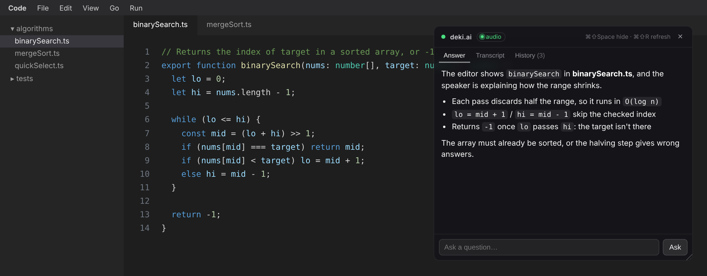

# Deki.ai — local AI overlay (portfolio demo)

An always-on-top Electron overlay that captures your screen and system audio,
transcribes speech locally with whisper.cpp, and streams a response from a
local Ollama vision model. Everything runs on your machine — no cloud APIs,
no API keys.



<sub>UI preview: the real overlay page rendered over a mock editor with sample
content. The models' answers will vary.</sub>

This is a portfolio/learning project demonstrating screen capture, overlay
windows, local LLM inference, and local speech-to-text. It is **not** built
for use in real interviews or exams: the overlay does not hide itself from
screen shares or recordings — it behaves like any other window, so anyone
viewing a shared screen sees it too.

## Prerequisites

1. **Node.js 18+** (`node --version`)
2. **A C/C++ compiler toolchain + CMake**, needed to build `whisper.cpp` locally via `nodejs-whisper`:
   - macOS: Xcode Command Line Tools (`xcode-select --install`) + `brew install cmake`
   - Linux: `sudo apt install build-essential cmake`
   - Windows: MSYS2 or MinGW-w64 (make sure `make`/`mingw32-make` is on PATH) + CMake
3. **ffmpeg on your PATH** — `nodejs-whisper` shells out to the `ffmpeg` CLI to
   convert recorded audio to 16kHz mono WAV before transcription:
   - macOS: `brew install ffmpeg`
   - Linux: `sudo apt install ffmpeg`
   - Windows: install from https://ffmpeg.org/download.html and add to PATH
4. **Ollama**, running locally as the inference engine, with two models
   pulled - one for captioning the screenshot, one for reasoning over that
   caption + the transcript (see "1. Backend" below for why it's split this
   way):
   ```bash
   ollama serve
   ollama pull moondream   # small, fast vision model - captions the screen
   ollama pull llama3      # text-only instruct model - does the reasoning
   # optional extra fallback for the reasoning stage if llama3 fails:
   ollama pull mistral
   ```
5. **A system-audio loopback device**, so the overlay transcribes what's
   actually playing on your computer (a call, a video, etc.) instead of
   whatever your microphone happens to pick up. The overlay looks for an audio
   *input* whose name matches a per-OS default; set `DEKI_AUDIO_DEVICE` (a
   case-insensitive regex or plain substring of the device name) to use a
   different one.

   **macOS — BlackHole** (default match: `blackhole`). This is a system audio
   driver install, not just an npm package, and needs a one-time manual step:
   ```bash
   brew install blackhole-2ch
   # then reboot - the installer requires it to take effect
   ```
   After rebooting, open **Audio MIDI Setup** (Spotlight search for it):
   1. Click the **+** button in the bottom-left → **Create Multi-Output Device**
   2. Check both your normal output (e.g. "MacBook Pro Speakers") **and**
      "BlackHole 2ch"
   3. Set this new Multi-Output Device as your system output (System Settings
      → Sound → Output), so you still hear audio while it's also captured
   4. Leave it set this way while using the overlay

   **Linux — PulseAudio/PipeWire monitor source** (default match: `monitor`).
   Every output device already has a "Monitor of …" input that carries what's
   playing, so there's nothing to install. Check it's visible with
   `pactl list short sources | grep monitor`. If you have several outputs,
   point at the right one, e.g.
   `DEKI_AUDIO_DEVICE="Monitor of Built-in Audio Analog Stereo"`.

   **Windows — VB-Audio Virtual Cable or Stereo Mix** (default match:
   `cable output|stereo mix`). Either install
   [VB-Audio Virtual Cable](https://vb-audio.com/Cable/) and set "CABLE Input"
   as your playback device (enable *Listen to this device* on "CABLE Output"
   in the classic Sound control panel's Recording tab so you still hear it),
   or enable the **Stereo Mix** recording device if your sound card has one.

## 1. Backend

```bash
cd server
npm install
npm run dev
```

Starts an Express + TypeScript server on `http://localhost:3232` (override with
`PORT`), forwarding to Ollama at `http://localhost:11434` (override with
`OLLAMA_URL`) through a **two-stage pipeline**:

1. **Vision stage** — the screenshot is captioned in plain text by a small
   vision model, `moondream` by default (`OLLAMA_VISION_MODEL`), using a
   short, direct prompt. Small vision models like moondream are tuned for
   this kind of simple captioning and produce empty/garbled output if given
   a longer instructional prompt, so this stage is kept deliberately minimal.
2. **Reasoning stage** — a text-only instruct model, `llama3` by default
   (`OLLAMA_MODEL`, falling back to `mistral` / `OLLAMA_FALLBACK_MODEL` if it
   fails), combines that screen caption with the rolling transcript and any
   typed question into the actual response. Images are never sent to this
   model, since plain instruct models like `llama3`/`mistral` reject
   multimodal input outright (HTTP 400: "model does not support multimodal
   requests") rather than ignoring it.

`POST /api/analyze` accepts `{ screenshot?, transcript?, question?,
stream? }`. Bodies are validated first: `screenshot` must be plain base64
(no `data:` prefix), `transcript` is capped at 20,000 characters and
`question` at 2,000, `stream` must be a boolean, and at least one of the
three inputs must be non-empty. Invalid requests get a JSON
`400 { "error": "..." }` without touching Ollama. By default the response streams back as NDJSON, one event per
line:

```
{"type":"chunk","text":"..."}     // a piece of the answer
{"type":"error","message":"..."}  // something failed mid-stream (Ollama error, cut connection, bad line)
{"type":"done","model":"llama3"}  // finished cleanly; names the model that answered
```

Every stream ends with exactly one `error` or `done`, so the overlay can show
*why* an answer stopped instead of just going quiet. Set `"stream": false` for
a single `{ response, model }` JSON payload instead. If the client disconnects
(e.g. a typed question interrupts an automatic cycle), the server aborts its
Ollama request.

`GET /health` reports whether Ollama is reachable and whether the configured
models are pulled — `200` when ready, `503` otherwise:

```json
{
  "ok": false,
  "ollama": { "url": "http://localhost:11434", "reachable": true },
  "models": {
    "vision":   { "name": "moondream", "installed": false },
    "text":     { "name": "llama3",    "installed": true },
    "fallback": { "name": "mistral",   "installed": false }
  }
}
```

The overlay polls this on startup and shows a banner with the exact fix
(start the backend, run `ollama serve`, or `ollama pull <model>`), pausing
automatic updates until it's resolved.

## 2. Whisper model download (one-time)

The overlay app depends on `nodejs-whisper`, which bundles whisper.cpp source
and builds a `whisper-cli` binary + downloads a ggml model the first time you
run its downloader:

```bash
cd overlay
npm install
npx nodejs-whisper download
# pick a model (base.en is a good default: fast, English-only)
```

This step is what actually invokes your compiler toolchain (`make`/`cmake`) to
build whisper.cpp — `npm install` alone does not compile anything.

## 3. Overlay app

```bash
cd overlay
npm start
```

- **Ctrl+Shift+Space** (⌘⇧Space on macOS) — show/hide the overlay
- **Ctrl+Shift+R** (⌘⇧R on macOS) — force an immediate screenshot + analysis cycle
- **Typing a question** always gets answered: it interrupts any automatic
  cycle that's running, and its answer stays on screen for 20s before
  automatic updates may replace it.
- Drag the header to move the overlay and the bottom-right corner to resize
  it; its size and position are remembered between launches.
- **Answer / Transcript / History** tabs: the latest answer, the rolling
  transcript the model is seeing, and the last 20 answers (marked as typed
  questions or automatic, and whether they were interrupted). Automatic
  refreshes don't pull you off the tab you're reading; a typed question jumps
  back to Answer.
- Otherwise, about 3s after each cycle *finishes*, it checks whether anything
  changed — a tiny 32×18 screen fingerprint plus new transcript words — and
  only then captures a screenshot (downscaled to 1280px wide) and sends
  `{ screenshot, transcript }` to the backend. A static screen with no new
  speech doesn't trigger new requests, and cycles never overlap. Automatic
  cycles pause while the overlay is hidden.
- System audio (via the loopback device from prerequisite #5) is transcribed in
  ~5s segments, one at a time and in order. If whisper can't keep up, the
  oldest waiting segments are dropped so the transcript stays current.
- If no matching loopback device is found, the overlay logs a warning to the
  DevTools console and simply skips audio transcription — screenshot-based
  analysis still works.

Configure the backend URL and Whisper model via env vars if you change
defaults:

```bash
DEKI_BACKEND_URL=http://localhost:3232 WHISPER_MODEL_NAME=base.en DEKI_AUDIO_DEVICE=blackhole npm start
```

`*.en` Whisper models are English-only, so transcription language is pinned
to `en` for them and auto-detected for multilingual models. Set
`WHISPER_LANGUAGE` (e.g. `es`) to override.

## Development

Both packages have tests (Node's built-in `node:test` runner) and ESLint;
the server is also type-checked with `tsc`.

```bash
cd server
npm run typecheck   # tsc --noEmit over app/ and test/
npm run lint
npm test            # stream relay + /api/analyze against a fake Ollama
npm run build       # compile to dist/, then `npm start` runs it

cd ../overlay
npm run lint
npm test            # whisper output cleanup + window position restore
```

The server is split so it can be tested without Ollama: `app/app.ts` builds
the Express app around an injectable `fetch`, `app/ollama.ts` wraps the
caption → reasoning pipeline, `app/stream.ts` relays Ollama's NDJSON stream,
and `app/server.ts` just reads config and listens. The overlay's testable
logic lives in Electron-free modules under `overlay/lib/`.

## Notes

- Local-dev only: no deployment config or cloud hosting. GitHub Actions CI
  (`.github/workflows/ci.yml`) runs the server typecheck, lint, tests and
  build, plus the overlay lint and tests, on every push to `main` and every PR.
- All inference (LLM + speech-to-text) runs on-device against Ollama and
  whisper.cpp — nothing leaves your machine.
- The overlay does not attempt to hide from screen capture/sharing by design.
